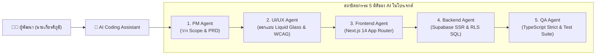

# 🤖 บันทึกการใช้งานปัญญาประดิษฐ์ในการพัฒนาโครงงาน (AI Usage Log)
## โครงงาน: Book Sangdai (บุ๊ค สั่งได้) — Digital Commerce Platform

* **ผู้พัฒนา:** นายเกียรติภูมิ หารศรีนาถ
* **รหัสนักศึกษา:** 64332110242-2
* **โมเดลปัญญาประดิษฐ์หลัก:** Gemini 3.8 Flash & Pro (ผ่านแพลตฟอร์ม Google DeepMind Antigravity)
* **สถาปัตยกรรมเอเจนต์:** Multi-Agent Pipeline (Product Manager, UI/UX Designer, Frontend Developer, Backend Developer, QA Engineer)

---

## 1. บทนำและแนวทางการนำ AI มาประยุกต์ใช้ (AI Methodology)

ในการพัฒนาแพลตฟอร์ม **Book Sangdai** ได้นำระบบ **Agentic AI Coding Assistant** เข้ามาเป็นคู่คิดในการพัฒนาโปรแกรม (Pair Programming) และทำหน้าที่เป็นผู้ช่วยตรวจสอบคุณภาพสถาปัตยกรรมระดับ Full-Stack โดยแบ่งบทบาทการทำงานออกเป็น 5 มิติ เพื่อให้ได้ผลลัพธ์ที่เป็นระบบและป้องกันข้อผิดพลาด:

---

## 2. ลำดับขั้นตอนและประวัติการสั่งงาน AI (Chronological AI Prompts & Development Log)

### 📌 ระยะที่ 1: การกำหนดแนวคิด สถาปัตยกรรม และดีไซน์ระบบ (Architecture & Design)
* **คำสั่งหลัก (Prompt):**
  > *"ต้องการพัฒนาแพลตฟอร์มอีคอมเมิร์ซสำหรับขาย E-Books และสินค้าดิจิทัลในชื่อ 'Book Sangdai' สไตล์ Liquid Glass แบบ Apple Minimalist ให้ใช้ Next.js 14 App Router, TypeScript, Tailwind CSS และ Supabase ช่วยออกแบบโครงสร้างโปรเจกต์และวางผังฐานข้อมูล"*
* **บทบาทของ AI:**
  - กำหนดโครงสร้างโฟลเดอร์แบบ App Router และ Data Model สำหรับสินค้า คำสั่งซื้อ และผู้ใช้งาน
  - ออกแบบ Design Tokens สีโทนขาว-เทาดำ (Charcoal `#1d1d1f`, Porcelain `#fbfbfd`, Cyan/Azure `#0071e3`)
  - สร้างไฟล์ตั้งค่า `tailwind.config.ts` และจัดเตรียม Schema ฐานข้อมูล PostgreSQL พร้อมเปิด Row Level Security (RLS)

---

### 📌 ระยะที่ 2: ระบบยืนยันตัวตนและการคุ้มครองข้อมูลส่วนบุคคล (Auth & Consent Gate)
* **คำสั่งหลัก (Prompt):**
  > *"ช่วยทำระบบสมัครสมาชิกและเข้าสู่ระบบด้วย Google OAuth และ Gmail ผ่าน Supabase SSR พร้อมทั้งเพิ่มเงื่อนไข Consent Gate ให้ผู้ใช้ต้องเลื่อนอ่านข้อตกลงการใช้งานและนโยบายความเป็นส่วนตัว (EULA & PDPA) จนครบ 100% ถึงจะกดยอมรับและเข้าใช้งานได้"*
* **บทบาทของ AI:**
  - สร้าง Middleware สำหรับรีเฟรช Cookie เซสชันอัตโนมัติ (`src/middleware.ts`)
  - พัฒนาคอมโพเนนต์ `ConsentReaderModal.tsx` คำนวณความสูงการเลื่อน (`scrollTop + clientHeight >= scrollHeight - 5`) ป้องกันการกดข้าม
  - แก้ไขปัญหา Race condition ระหว่าง OAuth callback กับการซิงค์ข้อมูลโปรไฟล์ด้วย Single-Flight Promise Deduplication ใน `AuthContext.tsx`

---

### 📌 ระยะที่ 3: ระบบชำระเงิน PromptPay QR และระบบตรวจสอบสลิป (Payment & Slip Workflow)
* **คำสั่งหลัก (Prompt):**
  > *"ต้องการสร้างระบบชำระเงินด้วย PromptPay QR Code ที่คำนวณยอดเงินจริงและสร้าง Checksum CRC16 ตามมาตรฐาน EMVCo พร้อมให้ลูกค้าอัปโหลดสลิปได้ และมีหน้าให้ร้านค้ากดตรวจสอบสลิปก่อนอนุมัติปล่อยไฟล์ดาวน์โหลด"*
* **บทบาทของ AI:**
  - เขียนฟังก์ชันคำนวณ CRC16 Checksum สำหรับ PromptPay payload ใน `src/lib/promptpay.ts`
  - สร้าง API Route `/api/payment/slip` บันทึกสลิปลงใน Private Storage Bucket
  - ออกแบบหน้าแคชเชียร์ `/checkout` พร้อมตัวนับเวลาถอยหลัง 10 นาที และ Real-time Polling สถานะคำสั่งซื้อ

---

### 📌 ระยะที่ 4: การรักษาความปลอดภัยและการแยกสิทธิ์ Multi-Tenant (Security & Role Isolation)
* **คำสั่งหลัก (Prompt):**
  > *"คำสั่งซื้อ และสลิปโอนเงิน ให้แยกประเภท type user ของใครของมัน โดยลูกค้าเห็นเฉพาะของตัวเอง ร้านค้าเห็นเฉพาะออเดอร์ของร้านตนเอง และแอดมินเห็นทั้งหมด พร้อมทั้งกำหนดว่าถ้าไม่ login จะไม่สามารถชำระเงินได้"*
* **บทบาทของ AI:**
  - ปรับปรุง `GET & POST /api/orders` และ `POST /api/payment/slip` ให้ดึงข้อมูลผู้ใช้จาก Bearer Token หรือ Session Cookie เสมอ หากไม่มีตัวตนจะส่ง `401 Unauthorized` (`requireLogin: true`)
  - กรองข้อมูลคำสั่งซื้อในระดับฐานข้อมูลและ API:
    - Customer: `WHERE user_id = currentUser.id`
    - Merchant: `WHERE merchant_id = currentUser.id`
    - Admin: เข้าถึงได้ทั้งหมด
  - เพิ่มระบบป้องกันการลบสินค้า/ออเดอร์ผิดพลาด โดยบังคับให้ผู้ใช้กรอกรหัสยืนยันตัวตน (Catalog Code / Order ID) เป็นตัวหนังสือสีแดงให้ตรงกันก่อนลบ

---

### 📌 ระยะที่ 5: การทดสอบอัตโนมัติและไปป์ไลน์ CI/CD (Testing & GitHub Actions)
* **คำสั่งหลัก (Prompt):**
  > *"จัดทำชุดทดสอบอัตโนมัติ (Automated Tests) เพื่อตรวจสอบ PromptPay CRC16, ความถูกต้องของ Order ID, การป้องกัน Path Traversal, และการแยกสิทธิ์ Multi-Tenant พร้อมตั้งค่า GitHub Actions CI Workflow ตรวจสอบโค้ดก่อน Deploy"*
* **บทบาทของ AI:**
  - สร้างสคริปต์ `tests/automated_suite.test.js` ครอบคลุม 5 Test Suites จำนวน 13 Test Cases (ผ่าน 100%)
  - กำหนดไฟล์ GitHub Actions `.github/workflows/ci.yml` รันบน Node.js 20 ทดสอบทั้ง `tsc --noEmit`, `npm test` และ `npm run build`
  - ตรวจสอบความเข้ากันได้ตามมาตรฐานการเข้าถึง W3C WCAG 2.1 ระดับ AA

---

## 3. เทคนิค Prompt Engineering ที่ประยุกต์ใช้ในโครงการ

1. **Role-Based System Prompting:** กำหนดกรอบความคิดให้ AI รับบทเป็นผู้เชี่ยวชาญเฉพาะทาง (เช่น Security Reviewer, QA Tester, Full-Stack Architect) ทำให้ข้อเสนอแนะมีความลึกซึ้งและแม่นยำ
2. **Chain-of-Thought (CoT) & Step-by-Step Reasoning:** ให้ AI วิเคราะห์ผลกระทบก่อนลงมือแก้โค้ด โดยเฉพาะจุดที่มีความเชื่อมโยงสูง เช่น Next.js Server Components, Cookie Management, และ Supabase RLS
3. **Living Documentation Protocol:** บันทึกข้อมูลและสถาปัตยกรรมที่อัปเดตลงในไฟล์ `.ai_docs/` ทุกครั้ง เพื่อไม่ให้บริบทของระบบหลุดลอยเมื่อเริ่มรอบการทำงานใหม่
4. **Automated Verification Loop:** หลังเขียนโค้ดเสร็จ สั่งให้ AI รันคำสั่ง `npx tsc --noEmit` และ `npm run build` เพื่อตรวจจับข้อผิดพลาดทันทีโดยไม่ปล่อยให้สะสม

---

## 4. บทสะท้อนและผลการประเมินการใช้ AI (Evaluation & Self-Reflection)

* **ความเร็วในการพัฒนา (Development Velocity):** การใช้ AI ช่วยลดระยะเวลาในการเขียน Boilerplate Code, การจัดทำเอกสารข้อกำหนด, และการแปลง Logic ทางคณิตศาสตร์ (เช่น PromptPay CRC16) ได้เร็วกว่าการเขียนด้วยตนเองทั้งหมดประมาณ **5 - 8 เท่า**
* **ความถูกต้องและความปลอดภัย (Code Correctness & Security):** AI ช่วยตรวจสอบจุดบกพร่องที่มองข้ามได้ง่าย เช่น ช่องโหว่ Path Traversal ในการส่งมอบไฟล์ หรือปัญหา Implicit `any` ใน TypeScript
* **จุดที่ยังจำเป็นต้องใช้มนุษย์กำกับดูแล (Human-in-the-Loop):**
  - การตัดสินใจด้านสุนทรียภาพของดีไซน์ (Liquid Glass UI Tweaking)
  - การกำหนดนโยบายทางธุรกิจและขอบเขตทางวิชาการ
  - การจัดการความลับระดับเซิร์ฟเวอร์ (API Secret Keys, Google Cloud OAuth Client ID) ซึ่งผู้พัฒนาต้องเป็นผู้ดำเนินการผ่าน Dashboard จริงเพื่อความปลอดภัยสูงสุด

---

*เอกสารฉบับนี้จัดทำขึ้นเป็นส่วนหนึ่งของรายงานโครงงาน Book Sangdai เพื่อบันทึกหลักฐานความโปร่งใสและกระบวนการนำเทคโนโลยีปัญญาประดิษฐ์มาประยุกต์ใช้ในการศึกษา*
