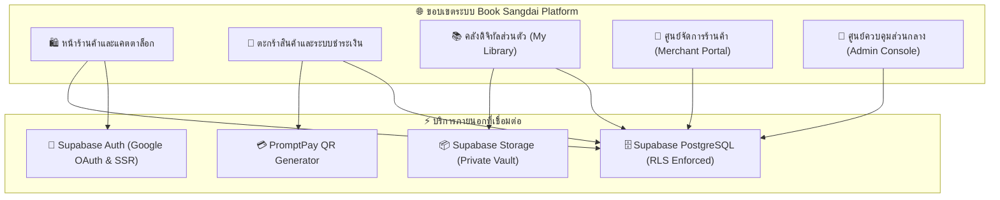

# 📋 เอกสารข้อกำหนดของระบบ (System Specification)
## โครงงาน: Book Sangdai (บุ๊ค สั่งได้) — Digital Commerce Platform

* **ผู้พัฒนา:** นายเกียรติภูมิ หารศรีนาถ (Kiatphum Hansrinath)
* **เวอร์ชันระบบ:** 2.0.0
* **วันที่ปรับปรุงล่าสุด:** ตุลาคม 2026

---

## 1. บทนำและวัตถุประสงค์ (Introduction & Objectives)

### 1.1 ที่มาและความสำคัญ
ในยุคดิจิทัล การซื้อขายผลงานสร้างสรรค์ ซอร์สโค้ด แม่แบบดีไซน์ (Templates) และหนังสืออิเล็กทรอนิกส์ (E-Books) มีการเติบโตอย่างรวดเร็ว อย่างไรก็ตาม แพลตฟอร์มส่วนใหญ่มักประสบปัญหาด้านการคุ้มครองสิทธิ์ของผู้ซื้อ การรั่วไหลของไฟล์มาสเตอร์ และความยุ่งยากในการแยกสิทธิ์ระหว่างร้านค้าหลายราย (Multi-Tenant Isolation)

### 1.2 วัตถุประสงค์ของโครงการ
1. พัฒนาแพลตฟอร์มการซื้อขายสินค้าดิจิทัลและอีบุ๊กด้วยสถาปัตยกรรมเว็บสมัยใหม่ (Next.js 14 App Router)
2. วางระบบรักษาความปลอดภัยระดับตู้นิรภัยดิจิทัล (Digital Vault) ด้วย Private Storage, Time-Limited Signed URLs (15 นาที) และ Dynamic PDF Watermarking
3. ออกแบบระบบชำระเงินที่สะดวก รวดเร็ว และตรวจสอบได้จริงผ่าน Dynamic PromptPay QR Code และระบบตรวจสอบสลิปโอนเงิน
4. รองรับการใช้งานแบบ Multi-Tenant แยกสิทธิ์การเข้าถึงข้อมูลระหว่าง ลูกค้า (Customer), ร้านค้า (Merchant) และผู้ดูแลระบบ (Admin) อย่างเด็ดขาด

---

## 2. ขอบเขตของระบบ (System Scope & Boundaries)



---

## 3. ข้อกำหนดเชิงหน้าที่ (Functional Requirements: FR)

| รหัส | หมวดหมู่ | รายละเอียดข้อกำหนดเชิงหน้าที่ | สิทธิ์ที่เข้าถึงได้ |
| :--- | :--- | :--- | :--- |
| **FR-01** | **Authentication** | สมัครสมาชิกและเข้าสู่ระบบด้วย Google OAuth และ Email/Password ผ่าน `@supabase/ssr` ปลอดภัยจาก XSS ด้วย HttpOnly Cookies | ทุกคน |
| **FR-02** | **Consent Gate** | กำหนดให้ผู้ใช้ต้องเลื่อนอ่านข้อกำหนดการใช้งาน (Terms of Service) และนโยบายความเป็นส่วนตัว (Privacy Policy) จนครบ 100% จึงจะสามารถลงทะเบียนได้ | ผู้ใช้ใหม่ |
| **FR-03** | **Catalog & Search** | ค้นหา กรอง และจัดหมวดหมู่สินค้าดิจิทัล (E-Book, Notion, Figma, Code, Assets) พร้อมระบบคำนวณส่วนลดอัตโนมัติ | ทุกคน |
| **FR-04** | **Checkout & Payment Guard** | บังคับให้ผู้ใช้ต้องเข้าสู่ระบบก่อนดำเนินการชำระเงิน เพื่อผูกประวัติและสิทธิ์ดาวน์โหลดกับบัญชี ป้องกัน Orphan Orders | ลูกค้าที่เข้าสู่ระบบ |
| **FR-05** | **PromptPay QR Engine** | สร้าง QR Code พร้อมเพย์ตามยอดเงินจริง พร้อมกำหนดรหัสอ้างอิงเฉพาะ (PromptPay Ref) และนับเวลาถอยหลัง 10 นาที | ลูกค้า |
| **FR-06** | **Slip Verification** | อัปโหลดสลิปการโอนเงินเข้า Private Bucket ให้ร้านค้าตรวจสอบยอดเงินจริงก่อนกดอนุมัติปล่อยไฟล์ | ลูกค้า & ร้านค้า |
| **FR-07** | **Digital Asset Delivery** | สร้าง Time-Limited Signed URL (15 นาที) สำหรับดาวน์โหลดไฟล์มาสเตอร์ พร้อมฝังลายน้ำชื่อ-อีเมลผู้ซื้อบนไฟล์ PDF | ลูกค้าที่ชำระเงินแล้ว |
| **FR-08** | **Merchant Multi-Tenancy** | ร้านค้าแต่ละรายสามารถจัดการสินค้า ดูยอดขาย และตรวจสอบสลิปได้เฉพาะคำสั่งซื้อสินค้าของร้านตนเองเท่านั้น | ร้านค้า (Merchant) |
| **FR-09** | **Deletion Protection** | การลบสินค้าหรือประวัติธุรกรรม ต้องผ่านการกรอกรหัสยืนยันตัวตน (Catalog Code / Order ID) เป็นตัวหนังสือสีแดงตรงกัน 100% | ร้านค้า & ลูกค้า |
| **FR-10** | **Admin Supervision** | ตรวจสอบภาพรวม GMV ของแพลตฟอร์ม อนุมัติ/ปฏิเสธใบสมัครเปิดร้านค้า และจัดการบัญชีผู้ใช้ | ผู้ดูแลระบบ (Admin) |

---

## 4. ข้อกำหนดที่มิใช่เชิงหน้าที่ (Non-Functional Requirements: NFR)

1. **ด้านความปลอดภัย (Security & RLS):**
   - ฐานข้อมูลเปิดใช้งาน Row Level Security (RLS) บนทุกตาราง
   - ปฏิเสธการเข้าถึง API endpoint ที่ไม่ได้รับอนุญาตด้วย HTTP Status `401 Unauthorized` และ `403 Forbidden`
   - รหัสผ่านของผู้ใช้ถูกแฮชด้วยอัลกอริทึมมาตรฐานของ Supabase Auth
2. **ด้านประสิทธิภาพ (Performance):**
   - หน้าแรกและหน้าแคตตาล็อกโหลดเสร็จสิ้นภายใน 1.5 วินาที
   - การประมวลผลลายน้ำ PDF ใช้เวลาเฉลี่ยไม่เกิน 800 มิลลิวินาที
   - ใช้ Next.js Image Optimization ปรับขนาดรูปภาพปกอัตโนมัติ
3. **ด้านความพร้อมใช้งาน (Availability & Reliability):**
   - สถาปัตยกรรม Serverless ทำงานบน Vercel Edge Network พร้อม SLA 99.9%
   - ฐานข้อมูล PostgreSQL โฮสต์บนคลัสเตอร์ Supabase ที่รองรับ Auto-Failover
4. **ความเข้ากันได้ของระบบ (Compatibility):**
   - รองรับเว็บเบราว์เซอร์หลัก: Google Chrome, Safari, Mozilla Firefox, Microsoft Edge
   - รองรับ Desktop App ผ่าน Electron สำหรับระบบปฏิบัติการ Windows
   - รองรับ Mobile App ผ่าน Capacitor สำหรับ iOS และ Android

---

## 5. การจำแนกสิทธิ์ผู้ใช้งาน (Role Matrix)

| ความสามารถของระบบ | ผู้เยี่ยมชม (Guest) | ลูกค้า (Customer) | ร้านค้า (Merchant) | แอดมิน (Admin) |
| :--- | :---: | :---: | :---: | :---: |
| ค้นหาและดูตัวอย่างสินค้า | ✅ | ✅ | ✅ | ✅ |
| เพิ่มสินค้าลงในตะกร้า | ✅ | ✅ | ✅ | ✅ |
| สั่งซื้อและชำระเงิน PromptPay | ❌ | ✅ | ✅ | ✅ |
| ดูคลังหนังสือและดาวน์โหลดไฟล์ | ❌ | ✅ (เฉพาะของตนเอง) | ✅ (เฉพาะของตนเอง) | ✅ |
| จัดการสินค้าในร้าน (CRUD) | ❌ | ❌ | ✅ (เฉพาะของร้านตนเอง) | ✅ (ทุกร้าน) |
| ตรวจสอบสลิปและอนุมัติปล่อยไฟล์ | ❌ | ❌ | ✅ (เฉพาะออเดอร์ร้านตนเอง) | ✅ (ทุกออเดอร์) |
| ส่งออกรายงานยอดขาย (CSV) | ❌ | ❌ | ✅ (เฉพาะของร้านตนเอง) | ✅ (ภาพรวมระบบ) |
| อนุมัติการเปิดร้านค้าใหม่ | ❌ | ❌ | ❌ | ✅ |
| จัดการสิทธิ์และระงับผู้ใช้งาน | ❌ | ❌ | ❌ | ✅ |

---

## 6. โครงสร้างข้อมูลหลัก (Data Schema Overview)

```text
1. public.profiles
   ├── id (UUID, PK -> auth.users)
   ├── email (TEXT, NOT NULL)
   ├── full_name (TEXT)
   ├── avatar_url (TEXT)
   ├── role (TEXT: 'user' | 'merchant' | 'admin')
   ├── store_name (TEXT)
   ├── promptpay_id (TEXT)
   └── terms_accepted_at (TIMESTAMPTZ)

2. public.products
   ├── id (TEXT, PK)
   ├── title (TEXT, NOT NULL)
   ├── price (NUMERIC, NOT NULL)
   ├── original_price (NUMERIC)
   ├── category (TEXT)
   ├── file_name (TEXT)
   ├── merchant_id (UUID, FK -> profiles.id)
   └── merchant_name (TEXT)

3. public.orders
   ├── id (TEXT, PK: ORD-2026-XXXX)
   ├── user_id (UUID, FK -> profiles.id)
   ├── customer_name (TEXT)
   ├── customer_email (TEXT)
   ├── total_amount (NUMERIC)
   ├── status (TEXT: 'PENDING' | 'PAID' | 'EXPIRED')
   ├── promptpay_ref (TEXT)
   ├── slip_url (TEXT)
   └── merchant_id (UUID)

4. public.order_items
   ├── id (UUID, PK)
   ├── order_id (TEXT, FK -> orders.id)
   ├── product_id (TEXT, FK -> products.id)
   ├── title (TEXT)
   └── price (NUMERIC)
```

---

*เอกสารฉบับนี้จัดทำขึ้นเป็นส่วนหนึ่งของรายงานโครงงาน Book Sangdai สำหรับการประเมินผลเชิงวิชาการ*
