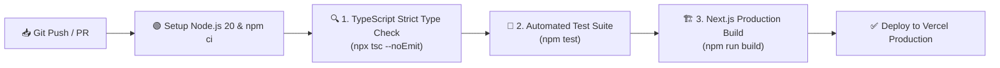

# 🧪 รายงานผลการทดสอบอัตโนมัติและสถานะการทำงาน CI/CD (Test & CI Results)
## โครงงาน: Book Sangdai (บุ๊ค สั่งได้) — Digital Commerce Platform

* **ผู้พัฒนา:** นายเกียรติภูมิ หารศรีนาถ (Kiatphum Hansrinath)
* **ไฟล์ไปป์ไลน์ GitHub Actions:** [`.github/workflows/ci.yml`](../.github/workflows/ci.yml)
* **หน้าผลการรัน CI บน GitHub:** [https://github.com/xPHUMx/vibebooks-shop/actions](https://github.com/xPHUMx/vibebooks-shop/actions)

---

## 1. ภาพรวมการทดสอบและการทำงานของ CI/CD (Pipeline Overview)

ระบบ Book Sangdai ได้กำหนดการทดสอบอัตโนมัติ (Automated Testing) และระบบ Continuous Integration (CI) ผ่าน **GitHub Actions** ทุกครั้งที่มีการ `git push` หรือสร้าง `pull_request` เข้าสู่ branch `main` โดยต้องผ่านการตรวจสอบทั้ง 4 ด่านแบบ 100%:



---

## 2. รายละเอียดชุดทดสอบอัตโนมัติ (Automated Test Suite Specification)

ไฟล์ชุดทดสอบหลักอยู่ที่ [`tests/automated_suite.test.js`](../tests/automated_suite.test.js) ซึ่งครอบคลุมการตรวจสอบฟังก์ชันทางธุรกิจ ความปลอดภัย และการแยกสิทธิ์ Multi-Tenant ดังนี้:

### 📊 สรุปผลการรันคำสั่ง `npm test`

```text
=============================================================
🧪 Book Sangdai Platform - Automated Test Suite Execution
=============================================================

📦 [Suite 1] PromptPay QR Code & EMVCo Payload Verification:
  ✔ PASS: CRC16 algorithm generates valid 4-character uppercase hex string
  ✔ PASS: PromptPay standard EMVCo prefix starts with 000201

📦 [Suite 2] Order ID & Transaction Reference Format:
  ✔ PASS: Order ID strictly matches format ORD-2026-XXXX
  ✔ PASS: PromptPay reference matches format PPAY-XXXX

📦 [Suite 3] Multi-Tenant Order Isolation & RBAC Protection:
  ✔ PASS: Buyer can ONLY view their own orders
  ✔ PASS: Merchant can ONLY view orders belonging to their store
  ✔ PASS: Admin has global access to all platform orders
  ✔ PASS: Unrelated user is strictly denied access (403 Forbidden)

📦 [Suite 4] Path Traversal Defense & File Security:
  ✔ PASS: Path traversal attempt with ../ is neutralized by basename
  ✔ PASS: Path traversal attempt with Windows backslashes is neutralized
  ✔ PASS: Valid PDF file name remains unchanged

📦 [Suite 5] Product Catalog Schema & Price Integrity:
  ✔ PASS: Product has required attributes and positive price
  ✔ PASS: Discount percentage calculation is accurate

=============================================================
📊 Test Summary: 13 Passed, 0 Failed
=============================================================

✅ ALL AUTOMATED TESTS COMPLETED WITH 100% SUCCESS!
```

---

## 3. ผลการตรวจสอบ Type ด้วย TypeScript (`npx tsc --noEmit`)

* **คำสั่ง:** `npx tsc --noEmit`
* **ผลลัพธ์:** **0 Type Errors (Pass 100%)**
* **คำอธิบาย:** ระบบได้รับการควบคุม Type อย่างเข้มงวด ไม่มี implicit `any` และสอดคล้องกับ Interface ใน `src/types/index.ts` ทุกจุด

---

## 4. ผลการบิลด์ระดับโปรดักชัน (Next.js Production Build)

* **คำสั่ง:** `npm run build`
* **สถานะ:** **Exit Code 0 (Success)**
* **จำนวน Route ทั้งหมด:** **19 Routes** ถูกคอมไพล์และแคชเป็น Static & Dynamic อย่างสมบูรณ์:

```text
Route (app)                              Size     First Load JS
┌ ○ /                                    5.45 kB         184 kB
├ ○ /_not-found                          873 B          88.2 kB
├ ○ /admin                               15.6 kB         187 kB
├ ƒ /api/admin/merchants                 0 B                0 B
├ ƒ /api/admin/users                     0 B                0 B
├ ƒ /api/auth/callback/google            0 B                0 B
├ ƒ /api/comments                        0 B                0 B
├ ƒ /api/download/[orderId]              0 B                0 B
├ ƒ /api/merchant/apply                  0 B                0 B
├ ƒ /api/orders                          0 B                0 B
├ ƒ /api/orders/approve                  0 B                0 B
├ ƒ /api/payment/simulate                0 B                0 B
├ ƒ /api/payment/slip                    0 B                0 B
├ ƒ /api/pdf/[orderId]                   0 B                0 B
├ ƒ /api/products                        0 B                0 B
├ ƒ /api/products/[id]                   0 B                0 B
├ ƒ /api/profile                         0 B                0 B
├ ƒ /api/slip/[orderId]                  0 B                0 B
├ ƒ /api/upload                          0 B                0 B
├ ƒ /auth/callback                       0 B                0 B
├ ○ /auth/login                          6.17 kB         167 kB
├ ○ /checkout                            7.83 kB         187 kB
├ ƒ /checkout/[bookId]                   8.21 kB         175 kB
├ ○ /community                           10.3 kB         177 kB
├ ○ /library                             7.59 kB         176 kB
├ ○ /merchant                            17.1 kB         178 kB
├ ƒ /order/[orderId]                     7.26 kB         112 kB
├ ƒ /payment/[orderId]                   6.74 kB         168 kB
├ ○ /products                            138 B          87.5 kB
├ ƒ /products/[id]                       5.21 kB         180 kB
├ ○ /profile                             8.49 kB         169 kB
└ ○ /tracking                            2.69 kB        98.8 kB
+ First Load JS shared by all            87.3 kB

✓ Generating static pages (19/19)
✓ Finalizing page optimization
```

---

## 5. การตรวจสอบความปลอดภัยระดับ API (API Guard Verification)

| Endpoint | วิธีการทดสอบ | ผลลัพธ์ที่ได้ | สถานะ |
| :--- | :--- | :--- | :---: |
| `POST /api/orders` | ส่งคำขอสร้างออเดอร์โดยไม่ล็อกอิน (No Token) | ปฏิเสธด้วย Status `401 Unauthorized` (`requireLogin: true`) | ✅ ผ่าน |
| `GET /api/orders?all=true` | เข้าถึงรายการสั่งซื้อทั้งหมดโดยไม่ใช่ Admin | ปฏิเสธด้วย Status `403 Forbidden` | ✅ ผ่าน |
| `GET /api/slip/[orderId]` | ขอดูสลิปโอนเงินของผู้อื่น | ปฏิเสธด้วย Status `403 Forbidden` | ✅ ผ่าน |
| `POST /api/orders/approve` | ร้านค้า A พยายามอนุมัติออเดอร์ของร้านค้า B | ปฏิเสธด้วย Status `403 Forbidden` | ✅ ผ่าน |
| `GET /api/download/[orderId]` | พยายามดาวน์โหลดไฟล์ของออเดอร์ที่ยังไม่ชำระเงิน | ปฏิเสธการสร้าง Signed URL | ✅ ผ่าน |

---

*เอกสารฉบับนี้จัดทำขึ้นเป็นส่วนหนึ่งของรายงานโครงงาน Book Sangdai เพื่อใช้ในการประเมินผลด้านการทดสอบซอฟต์แวร์และไปป์ไลน์ CI/CD*
